# Economics Research Crew

面向**税收经济学、公共经济学、计量经济学与因果推断**的 AI 科研协作与论文写作系统。支持 **Windows 11 与 macOS / Linux**，自适应 **Claude Code、Antigravity CLI（`agy`）与 Codex CLI**；零外部 Python 依赖，不覆盖既有配置，不自动运行任何回归。

---

## 项目结构与意图路由全景图

<picture>
  <source media="(prefers-color-scheme: dark)" srcset="docs/architecture-dark.svg">
  <source media="(prefers-color-scheme: light)" srcset="docs/architecture.svg">
  
</picture>

> 上图为原生矢量动态图（直接自动播放数据流与路由脉冲，随深/浅色主题自动切换）；如需 4 视图聚焦、点击节点跳转源码行号与导出 PNG/SVG/WebM，可打开本地 [docs/architecture.html](docs/architecture.html)（或[在线交互版](https://htmlpreview.github.io/?https://github.com/shjzzzz/Economics-Research-Crew/blob/main/docs/architecture.html)）。

---

## 一、核心架构（四层知识流 + Meta 控制面）

| 层级 | 目录 | 职责与隔离边界 |
|---|---|---|
| **Tier 0 原始只读层** | `03-Literature/_sources/`、`06-Data/raw/`、库内既有笔记（文献库/知识库） | **不可变**（hook 拦写）；保持原位、按目录检索、不自动视为已核实结论 |
| **Tier 1 跨项目复利层** | `02-Areas/`、`03-Literature/`、`04-Theories/`、`05-Methods/`、`08-Research-Notes/`、`MOC/` | 跨项目复用的结构化文献卡（含 `cite_key` 与三层定位锚点）、机制页、方法页、综合页与枢纽页 |
| **Tier 2 项目执行层** | `01-Research-Projects/<项目>/`、`06-Data/{processed,metadata}/`、`07-Code/{stata,python,R}/` | 仅 `PROJECT.md` 进索引与双链图；`STATE.json`、`analysis-plan.md` 与 `paper/` 过程稿/版本快照不污染全库图谱 |
| **Tier 3 交付与归档层** | `09-Writing/`、`10-Archive/` | `09-Writing/` 仅放**非完整研究项目的独立文稿**（政策简报/评论/讲义）；`10-Archive/` 结项归档 |
| **Meta 控制面** | `Meta/` | **静态规范**（`purpose` / `research-standards` / `collaboration-protocol` / `style-guide` / `mechanism-library` / `ai-tells.json` / `upstream-ars.json`）、**协作账本**（`index` / `log` / `review-queue` / `decisions` / `constraints` / `source-registry`；另有 `aliases.csv` 术语别名表）、**脚本独占机读文件**（`citation-map.json` / `results-ledger.json` / `run-ledger.jsonl` / `folder-map.md` / `link-map.md`） |

两张自动生成地图（`Meta/folder-map.md`、`Meta/link-map.md`）及其精简版写入 `CLAUDE.md` / `AGENTS.md` 的 `ERC:MAP` 标记之间，由 `wiki_lint.py map` 生成。

---

## 二、经济学论文全周期论证脊柱（S1–S12）

| 阶段 | 负责 Skill | 内部 Agent | 核心产出 | 研究者关卡 |
|---|---|---|---|---|
| **S1 问题** | `/research-question` | — | `PROJECT.md`（问题、estimand、理想 vs 准实验、可行性） | 问题与 estimand 是否确定？ |
| **S2 文献** | `/literature-review` | `literature-agent` | 2–4 个争论簇文献矩阵、精确缺口、未核实清单 | 缺口是否真实、文献是否遗漏？ |
| **S3 机制与制度** | `/theory-modeling` + `/tax-policy-analysis` | `theory-agent`、`tax-policy-agent` | 竞争性假说与简化式映射；权威法源（含冲突适用）与政策冲击要素 | 假说能否推出？法源与冲击时点是否核实？ |
| **S4 识别设计** | `/causal-inference-audit` | `causal-inference-agent` | 威胁—检验—证伪矩阵、冻结 `analysis-plan.md`、因果措辞上限 | 识别假设是否可辩护？计划是否冻结？ |
| **S5 实证执行** | `/econometric-analysis` | `econometrics-agent`（唯一 Bash/PowerShell） | 模块化脚本、样本瀑布、`analysis-log.md`、结果入簿 `results-ledger.json` | 是否按计划执行、记录偏离并完成入簿？ |
| **S6 独立审查** | `/academic-review` | `academic-reviewer`（只读隔离） | 已读清单 + `F1/M1/m1` + 5 维分 + 分配归宿 + 框架锁定 + 7 类 AI 失效 | 独立审查意见是否完整汇报？ |
| **S7 决策** | `/research-pipeline` | Research Director + 研究者 | 接受进入写作 / 退回某阶段 / 停止 | 致命问题是否解决？（`--fatal-resolved`） |
| **S8 论文大纲** | `/paper-outline` | — | `paper/outline.md`（主张清单、6 步引言蓝图、文献布局、一表一问） | **C1**：论证脊柱与主张清单是否确定？ |
| **S9 引文核验** | `/literature-review` + `paper_tools cite` | — | `Meta/citation-map.json`（Crossref/人工确认 + `locator`）、`citations.bib` | **C2**：引文核验与定位锚点是否可接受？ |
| **S10 受限成稿** | `/paper-draft` | `paper-writer-agent` | `paper/draft.md`（仅 `[@key]`、`{{res:id}}`、`<!-- claim -->`）与对照表 | **C3**：主张覆盖度与经济量级是否准确？ |
| **S11 精修与润色** | `/paper-refine`（+ 可选 `/paper-polish`） | `paper-writer-agent` + `academic-reviewer` | `review verify` 预检、`versions/`、`reviews.json`、`rebuttal-matrix.md`、`polished.md` | **C4**：精修结果与可选润色（`polish check`）是否可接受？ |
| **S12 终检回流** | `/research-pipeline` | Research Director + 研究者 | `paper/final.md`、`paper/ai-disclosure.md`、7 类失效清零、`synthesis` 回流 | **C5**：投稿前清单与知识回流是否完成？ |

**知识库维护 3 个常驻 Skills**：

| Skill | 用途 | 核心机制 |
|---|---|---|
| `/ingest-source` | 两步摄入 `03-Literature/_sources/` 来源 | SHA256 去重 → 先分析停下等确认 → 写文献卡（含 `cite_key`）并关联概念页与双地图 |
| `/query-wiki` | 基于已积累知识库与决策记录作答 | 先读 `Meta/index.md` 与 `link-map.md` 枢纽页 → 沿 `[[双链]]` 展开，严格区分事实与推断 |
| `/wiki-lint` | 知识库确定性体检与语义审计 | `wiki_lint.py lint/map` + `paper_tools.py report` 联动 + 矛盾/过时/知识回流检查（批准后再修） |

---

## 三、确定性工具链与 Hooks

| 工具 / Hook | 核心命令或触发时机 | 解决的问题 |
|---|---|---|
| `orchestrator.py` | `init / status / next / artifact / verify / gate / fail / recover / enforce / log` | 机读项目状态机（`STATE.json`）与追加式运行账本（`Meta/run-ledger.jsonl`）；关卡仅由研究者决定 |
| `paper_tools.py` | `cite (add/from-note/import/zotero/zotero-note/open/verify/confirm/check/bib/ris/csl)`、`results (register/import/render/check)`、`claim check`、`review verify`、`refine (start/record/status)`、`polish (scan/check)`、`questions`、`report` | 引文与数字机械溯源、EndNote / Zotero 互通（RIS / BibTeX / CSL-JSON 导入导出，Zotero API 只读拉取，导入一律 `unverified`）、`--no-source-reason` 诚实空值、大纲主张覆盖度审计、NFC 审稿引述与推荐文献存在性核验、润色零内容变更证明 |
| `wiki_lint.py` | `lint`、`map [--check]`、`hash` | 确定性体检、生成双地图并刷新 `ERC:MAP`；自动过滤 `paper/versions/` 与多项目 `PROJECT.md` 误报 |
| `tools/check_upstreams.py` | `list`、`check [--repo NAME] [--out FILE] [--json]`、`mark-audited --repo NAME --sha S [--tag T]` | **零 LLM 额度**一次检测 3 个上游（`academic-research-skills`、`paper-orchestra`、`obsidian-second-brain`），按各自清单映射受影响模块并输出原生适配简报；清单在 `payload/Meta/upstream-ars.json` 与 `tools/upstreams/*.json`；GitHub Actions 每周一自动运行，有更新时开 issue，**只检测，不自动改库** |
| `tools/check_ars_updates.py` | `check [--out FILE] [--json]`、`mark-audited --tag T --sha S` | ARS 单上游检测（`check_upstreams.py` 的底层，保持兼容） |
| `tools/erc_cli.py` + `install.sh` | `install / test / sync / check-ars` | Windows 11 与 macOS / Linux 跨平台安装、校验与同步，自动适配 `python` / `python3` hook 命令 |
| 7 个可选 Hooks（`-WithHooks`） | `session_context`、`protect_raw`、`orchestrator_guard`、`validate_frontmatter`、`validate_paper`、`routing_hint`、`orchestrator_record` | 会话启动/压缩后自动恢复项目阶段状态；拦截改写原始数据/机读账本/跳阶段/超并发；草稿未知引文/结果即时告警；确定性路由提示与派出记录（均设 `timeout: 10`） |

---

## 四、跨系统与多平台支持

| 维度 | 支持对象 | 规则与路径 | Hooks（`-WithHooks` / `--with-hooks`） | 状态 |
|---|---|---|---|---|
| **操作系统** | **Windows 11** | `Install-EconomicsResearchCrew.ps1`（PS 5.1 / 7）或 `python tools/erc_cli.py` | hook 命令使用 `python` | 已双宿主全量测试（354/354；本机安装 `claude` CLI 时 355/355，同时放置 extras 时 358/358） |
| **操作系统** | **macOS / Linux** | `./install.sh`（封装 `python3 tools/erc_cli.py`，纯 LF） | 自动适配为 `python3` | Python 模拟全量通过 + `bash -n` 通过；实体 macOS 未实机运行 |
| **AI CLI** | **Claude Code** | `CLAUDE.md` + `.claude/ECONOMICS-RESEARCH.md`、`.claude/{skills,agents,scripts,hooks}/`（原生 `effort`/`disallowedTools`/`PowerShell`） | `.claude/settings.json`（全 7 个 hooks，含 `SessionStart` 状态恢复与 `timeout: 10`） | 已测试（含 `claude plugin validate --strict`） |
| **AI CLI** | **Antigravity (`agy`)** | 根 `AGENTS.md`（`ERC:BEGIN…END`，≤24 KB）、`.agents/{skills,agents,scripts,hooks}/` | `.agents/hooks.json`（`protect_raw` + `routing_hint`） | 已冒烟测试 |
| **AI CLI** | **Codex CLI** | 同上 `AGENTS.md` + `.agents/{skills,agents,scripts}/` | 无（原始数据保护靠规则约束） | 仅结构生成，**未运行测试** |

---

## 五、安装与同步

### Windows 11（PowerShell 5.1 / 7）
```powershell
Set-ExecutionPolicy -Scope Process Bypass
.\Install-EconomicsResearchCrew.ps1 -VaultPath "D:\MyVault" -WhatIf                   # 预演（零写入）
.\Install-EconomicsResearchCrew.ps1 -VaultPath "D:\MyVault" -Platform all -WithHooks  # 全平台 + hooks（项目名默认取目录名，可加 -ProjectName "名称"）
.\Install-EconomicsResearchCrew.ps1 -VaultPath "D:\MyVault" -Update                   # 升级：差异写 .new，不覆盖
.\Sync-AgentsMd.ps1 -VaultPath "D:\MyVault"                                           # 同步 CLAUDE.md -> AGENTS.md
.\Test-EconomicsResearchCrew.ps1 -VaultPath "D:\MyVault"                              # 结构校验
```

### macOS / Linux（及跨平台 Python CLI）
```bash
chmod +x install.sh
./install.sh --vault ~/MyVault --dry-run                       # 预演（零写入）
./install.sh --vault ~/MyVault --platform all --with-hooks     # 全平台 + python3 hooks（--name "名称" 指定项目名，默认取目录名）
./install.sh --vault ~/MyVault --update                        # 升级：差异写 .new，不覆盖
./install.sh test --vault ~/MyVault                            # 结构校验
./install.sh sync --vault ~/MyVault                            # 同步 CLAUDE.md -> AGENTS.md
./install.sh check-ars                                                      # 检测 ARS 上游更新
./install.sh check-upstreams                                                # 检测全部 3 个上游更新
```

> 所有安装器只新增不覆盖，改动前自动备份 `CLAUDE.md`、`.mcp.json`、`.claude/settings.json`、`AGENTS.md`、`.agents/hooks.json` 至 `_erc-backups/<时间戳>/`。详细操作手册见 [docs/USAGE.md](docs/USAGE.md)。

---

## 六、设计借鉴、可选扩展与合规边界

| 来源项目 | 许可证 | 本项目采用方式 | 明确边界 |
|---|---|---|---|
| `llm_wiki` | — | 借鉴“可积累 Wiki”思路（`purpose` / `index` / `log` / 两步摄入 / `lint`） | 原生实现，不引入桌面端或额外 MCP |
| `My-Brain-Is-Full-Crew` | — | 借鉴 hooks 强制执行与回归测试；可选 `-WithUpstream -RepoUrl <地址>` 隔离构建 | 默认不装上游；不自动导入会冲突的上游 dispatcher |
| `google-research/paper-orchestra` | Apache-2.0 | 借鉴受限输入写作、引文表、结果追溯与精修回退理念 | 原生重写，不含其代码（其流水线依赖外部 API 密钥与 LaTeX，与本项目零依赖原则冲突）；保留经济学研究者关卡；清单 `tools/upstreams/paper-orchestra.json` 持续追踪 |
| `Imbad0202/academic-research-skills`（截至 `v3.24.4`） | CC-BY-NC-4.0 | 借鉴苏格拉底防越位、让步门槛、框架锁定、L3 锚点、`data_access_level`、7 类 AI 失效闸门、R&R 矩阵、审稿引述/推荐文献核验、按稿件日期评判、分配归宿核查、`--no-source-reason` 诚实空值与 `Advisory` 分层 | **仅借设计模式并在本项目原生重写，绝不含其任何代码或提示词**；通过 `tools/check_ars_updates.py` 持续追踪 |
| `eugeniughelbur/obsidian-second-brain` | MIT | 已吸收（原生重写）：证据页新鲜度提示、带无答案用例的检索自测；摄入时更新已有页、共享日志等本项目已有对应 | 仅借设计模式；**排除**自主改写、定时自改和需密钥的研究集成，因其与只读层、先报告后修改、`constraints.md` 不得由 AI 自改的规则冲突；本机若已装其插件，项目 Skill 优先；清单 `tools/upstreams/obsidian-second-brain.json` 持续追踪 |
| `academic-humanizer` / `econ-writing-skill` / `humanizer-zh-academic` | MIT | 借鉴语言精修分层、经济学章节公式与中文学术套话分类（`Meta/ai-tells.json`） | 原生重写；**不采用**“降低 AIGC 检测率”目标，AI 参与须如实披露 |
| 2 个绘图 Skill（必装）：`thu-digitizer`、`scientific-visualization` | MIT（Rimagination；K-Dense Inc.，上游 `K-Dense-AI/scientific-agent-skills`） | 原样收录，各自目录内附上游 `LICENSE` | 未经本项目安全审计；按 MIT 条款保留版权声明 |
| `payload-extras/`（可选 `-WithExtras`） | 多为上游未附许可证 | 仅供用户本机自用的第三方 Skill（含 `publication-chart-skill` / `econ-visualization` / `copyplot` / `tikz`），**不随公开仓库分发**（已 gitignore） | 未经本项目审计、默认不安装、不配置任何 MCP |

---

## 七、首次对话与验证流程

### 首次只读自检提示词
```text
请读取 CLAUDE.md、.claude/ECONOMICS-RESEARCH.md、Meta/vault-map.md、Meta/research-standards.md。
只检查配置与目录，不修改知识库。报告已发现的 Agent、Skills、路径与潜在冲突。
```

### 回归验证命令
| 验证项 | 命令 | 说明 |
|---|---|---|
| 结构检查 | `.\Test-EconomicsResearchCrew.ps1 -VaultPath <库>` / `./install.sh test --vault <库>` | 校验 7 Agents、17 Skills、frontmatter、全部 `Meta/` 与 Hooks |
| 全量离线回归（Win11） | `pwsh -NoProfile -File tests\run.ps1` 与 `powershell -NoProfile -File tests\run.ps1` | 354 项测试（本机安装 `claude` CLI 时 355 项，同时放置 extras 时 358 项；支持 `-Section` 按节调试），全在临时目录运行，不触碰真实知识库 |
| 上游更新检查 | `python tools/check_upstreams.py check`（ARS 单独：`check_ars_updates.py check`） | 零 LLM 额度；无更新返回 `0`，有更新返回 `2` 并输出适配简报，抓取失败返回 `1`；`.github/workflows/upstream-watch.yml` 每周一自动运行 |
| 实机路由评测（可选） | `python tests/routing_eval.py --vault <临时库>` | 消耗 Claude 额度；覆盖 `tests/routing_cases.json` 16 个路由用例 |
